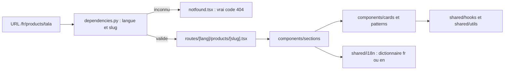

# Architecture

**Statut.** Retenue, 26 novembre 2026.
**Propriétaire.** @Espoir-Loem.
**Décisions liées.** D-002, D-003, D-004, D-006, D-007, D-012, D-013, D-014, D-015.

## Flux d'une URL à l'écran

Le serveur Python valide la langue et le slug avec `notFound()` de Nexy, à partir de `src/shared/utils/languages.py` et `detail_slugs.py`. Le client rend ensuite la route. Les slugs ont une seule source, `src/content/details.json`, lue par le serveur et par le client.

## Responsabilités des dossiers

| Dossier | Intention | Exemples |
|---|---|---|
| `src/routes/` | Une page par URL, qui compose des sections | `[lang]/about.tsx`, `layout.tsx`, `errors.tsx` |
| `src/components/sections.tsx` | Les zones d'une page | `AboutSection`, `CollectionSection` |
| `src/components/cards.tsx` | Les cartes qui représentent un élément | `ProductCard`, `WorkCard` |
| `src/components/patterns.tsx` | Les blocs réutilisés par plusieurs pages | `PageFrame`, `ContactPanel` |
| `src/components/layout.tsx` | Ce qui entoure toutes les pages | `Header`, `Footer`, `NavEntry` |
| `src/server.py` | Le point d'entrée FastAPI `app`, pour les hébergeurs qui lancent une application FastAPI sans `nx start` (Vercel). Il réexporte `nexy.app.app` et, si le dossier est en lecture seule, démarre depuis une copie dans `/tmp` | `uvicorn src.server:app` |
| `src/shared/ui/` | Les atomes sans connaissance du site, un fichier pluriel chacun | `buttons.tsx`, `links.tsx`, `images.tsx`, `logos.tsx`, `panels.tsx`, `social-icons.tsx` |
| `src/shared/hooks/` | La logique d'interface réutilisable | `use-open-menu.hook.ts`, `use-mobile-menu.hook.ts`, `use-social-links.hook.ts`, `use-copyright.hook.ts` |
| `src/shared/utils/` | Les fonctions pures, TypeScript et Python | `detail-href.util.ts`, `initials.util.ts`, `validate-email.util.ts`, `detail_slugs.py` |
| `src/shared/i18n/` | La langue et le contenu | `dictionaries.i18n.ts`, `use-content.i18n.ts` |
| `src/shared/types/` | Les types partagés | `detail.type.ts`, `site.type.ts` |
| `src/content/` | Les données partagées avec Python | `details.json`, `navigation.json`, `images.json`, `social.json` |

Les dépendances vont dans un seul sens : `routes` vers `sections`, puis `cards`, `patterns` et `layout`, puis `shared`. Un fichier de `shared/` n'importe jamais un composant de `components/`.

## Règles de composition

- Un composant ne fait que du rendu. Son état et ses événements viennent d'un hook.
- Les trois collections de la page d'accueil (services, produits, réalisations) passent par `CollectionSection` de `sections.tsx`, qui reçoit les données et la façon de rendre une carte.
- Les liens passent par `src/shared/ui/links.tsx`, qui ajoute le préfixe de langue à l'adresse.
- Les mouvements utilisent `motion.div` de Motion directement. `MotionConfig reducedMotion="user"` dans `src/routes/layout.tsx` respecte `prefers-reduced-motion` pour toute la page.
- Les textes viennent du dictionnaire. Un texte visible écrit en dur dans un composant est un défaut.

## Images

Les images des projets vont dans `public/`, en `webp` ou `avif` (le `svg` pour les illustrations), à la taille affichée. `npm run check:images` refuse le `png`, le `jpg` et le `gif`, et un fichier de plus de 200 ko (50 ko pour un `svg`). Elles s'affichent avec `Image` de `src/shared/ui/images.tsx`, ou avec `Picture` quand l'image vient du registre (taille lue dans l'entrée, `alt` vide, remplit sa boîte) : `width` et `height` obligatoires pour que la page ne bouge pas, `alt` obligatoire, chargement différé et décodage asynchrone par défaut. Une image visible dès l'ouverture de la page passe `loading="eager"`. `vercel.json` met en cache un an les fichiers de `assets/` (noms hachés) et un jour les images de `public/`.

### Couvertures des réalisations et des produits

`src/content/images.json` donne, pour chaque réalisation et chaque produit, le chemin de sa couverture et sa taille. Son groupe `about` nomme les quatre visuels de la page À propos (`hero`, `mission`, `detailA`, `detailB`). Les cartes et la page de détail la lisent par le dictionnaire. `tests/test_content_images.py` vérifie que chaque slug a une couverture, que le fichier existe et que sa taille correspond au `viewBox` d'un `svg`.

Les couvertures actuelles sont des illustrations abstraites en `svg` (`public/images/work/` et `public/images/products/`), dessinées sans texte et sans faux écran, en attendant les vraies images. Pour remplacer une couverture : déposer le fichier `webp` dans `public/images/`, puis changer `src`, `width` et `height` de son entrée dans `images.json`. Aucun composant ne change.

## Transitions de page

Nexy enveloppe chaque navigation du client dans `document.startViewTransition`, et la saute sous `prefers-reduced-motion`. Luilka n'ajoute aucune bibliothèque : `src/globale.css` règle le mouvement.

- L'en-tête porte `view-transition-name: site-header` : il reste fixe pendant le changement de page.
- L'ancienne page s'efface en 160 ms, la nouvelle monte de 16 pixels en 320 ms (`page-out`, `page-in`).
- La couverture d'une carte et celle de la page de détail portent le même nom, `cover-<type>-<slug>` (`src/shared/utils/cover-name.util.ts`). Le navigateur les relie : l'image de la carte devient l'image de la page, dans les deux sens.
- Sous `prefers-reduced-motion`, aucune animation ne démarre.

## Menu mobile et en-tête

Au-dessous de 1140 pixels, la navigation du bureau laisse la place à un bouton « Menu » (`MobileMenu` de `layout.tsx`, état dans `use-mobile-menu.hook.ts`). Le seuil est le même dans les deux classes, `max-[1140px]:hidden` et `min-[1140px]:hidden`, et `tests/test_responsive_layout.py` le vérifie. Il tient aux libellés français, plus longs que les anglais. Sous 440 pixels, l'action de contact de l'en-tête garde son icône et le menu porte un bouton « Nous contacter » lisible.

Aucune page ne défile de côté à 320 pixels : `ProcessBand` coupe son défilement avec `overflow-x-clip` et le pied de page laisse ses colonnes rétrécir.

## Liens des réseaux sociaux

`src/content/social.json` porte l'adresse de LinkedIn, de TikTok et de YouTube. Une adresse vide n'affiche rien : aucun lien n'est inventé. `tests/test_social_content.py` refuse une adresse qui n'est pas en `https` ou qui ne mène pas au bon réseau. Les icônes sont dessinées par `SocialIcon` (tracés de Simple Icons, domaine public), car Lucide ne porte pas les marques.

## Page À propos

Elle suit la maquette du titulaire (D-015, [page-a-propos.md](../UX/page-a-propos.md)). `src/routes/[lang]/about.tsx` compose `AboutHero`, `MissionSection`, `ValuesSection` et `TeamSection` de `sections.tsx`, puis le bloc de contact. `Breadcrumb` est dans `patterns.tsx`, `ValueCard` et `TeamCard` dans `cards.tsx`. La première valeur est la tuile centrale de la mosaïque, sur le panneau rayé de l'accueil (`StripedPanel`, `shared/ui/panels.tsx`).

Le texte vient du dictionnaire (`aboutPage` : mission, valeurs, équipe, visuels). Une liste vide masque sa section. Une carte d'équipe sans photo affiche les initiales de la personne (`initials.util.ts`). Ajouter une valeur ou une personne se fait dans le dictionnaire, sans toucher aux composants.

## Contenu et langue

`src/shared/i18n/dictionaries.i18n.ts` porte les deux langues avec le même type `Dictionary`. La navigation vient de `src/content/navigation.json`, lue aussi par `BrandService` côté Python. La langue se lit dans le premier segment de l'URL.

## Limites connues

Le HTML servi est une coquille et le contenu arrive après hydratation (D-003, Q-001). Les pages d'aperçu du chargement et de l'erreur ont été retirées. Les états restent couverts par `tests/client/feedback-states.test.tsx`.
