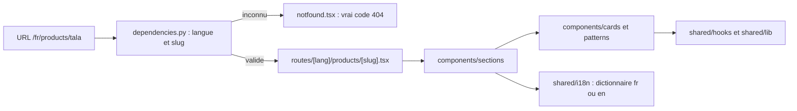

# Architecture

**Statut.** Retenue, 26 novembre 2026.
**Propriétaire.** @Espoir-Loem.
**Décisions liées.** D-002, D-003, D-004, D-006, D-007.

## Flux d'une URL à l'écran

Le serveur Python valide la langue et le slug avec `notFound()` de Nexy. Le client rend ensuite la route. Les slugs ont une seule source, `src/content/details.json`, lue par le serveur et par le client.

## Responsabilités des dossiers

| Dossier | Intention | Exemples |
|---|---|---|
| `src/routes/` | Une page par URL, qui compose des sections | `[lang]/about.tsx`, `layout.tsx`, `errors.tsx` |
| `src/components/sections/` | Une zone d'une page | `(home)/hero-section.tsx`, `collection-section.tsx` |
| `src/components/cards/` | Une carte qui représente un élément | `product-card.tsx`, `work-card.tsx` |
| `src/components/patterns/` | Un bloc réutilisé par plusieurs pages | `page-frame.tsx`, `contact-panel.tsx` |
| `src/components/layout/` | Ce qui entoure toutes les pages | `header.tsx`, `footer.tsx`, `navigation/` |
| `src/shared/ui/` | Les atomes sans connaissance du site | `button.tsx`, `link.tsx`, `motion-box.tsx` |
| `src/shared/hooks/` | La logique d'interface réutilisable | `use-open-menu.ts`, `use-newsletter.ts` |
| `src/shared/lib/` | Les fonctions pures | `detail-href.ts`, `validate-email.ts` |
| `src/shared/i18n/` | La langue et le contenu | `dictionaries.ts`, `use-content.ts` |
| `src/shared/types/` | Les types partagés | `detail.ts`, `site.ts` |
| `src/content/` | Les données partagées avec Python | `details.json`, `navigation.json` |

Les dépendances vont dans un seul sens : `routes` vers `sections`, puis `cards`, `patterns` et `layout`, puis `shared`. Un fichier de `shared/` n'importe jamais un composant de `components/`.

## Règles de composition

- Un composant ne fait que du rendu. Son état et ses événements viennent d'un hook.
- Les trois collections de la page d'accueil (services, produits, réalisations) passent par `collection-section.tsx`, qui reçoit les données et la façon de rendre une carte.
- Les liens passent par `src/shared/ui/link.tsx`, qui ajoute le préfixe de langue à l'adresse.
- Les mouvements passent par `src/shared/ui/motion-box.tsx`, qui respecte `prefers-reduced-motion`.
- Les textes viennent du dictionnaire. Un texte visible écrit en dur dans un composant est un défaut.

## Contenu et langue

`src/shared/i18n/dictionaries.ts` porte les deux langues avec le même type `Dictionary`. La navigation vient de `src/content/navigation.json`, lue aussi par `BrandService` côté Python. La langue se lit dans le premier segment de l'URL.

## Limites connues

Le HTML servi est une coquille et le contenu arrive après hydratation (D-003, Q-001). Les pages d'aperçu du chargement et de l'erreur ont été retirées. Les états restent couverts par `tests/client/FeedbackStates.test.tsx`.
