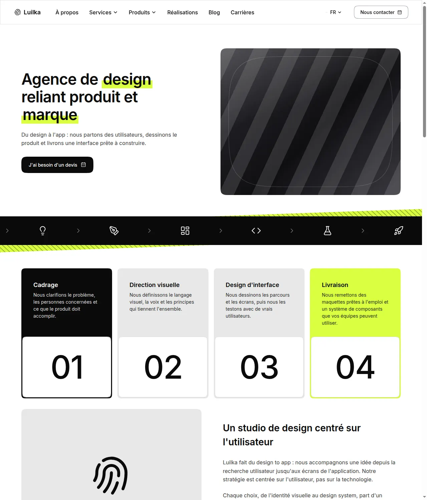

# Audit du thème et proposition de coloration

**Statut** : version 1, 26 novembre 2026. Proposition, rien n'est appliqué au-delà de D-018.
**Propriétaire** : @Espoir-Loem
**Documents liés** : [décisions](../Product/decisions.md) (D-018), [propositions de couleur](propositions-couleurs.md), [audit des pages](audit-pages-et-concurrence.md), [vision](../Product/vision.md)
**Sources** : notes de `research_notes/Positionnement design Luilka Afrique Congo/` (en particulier `white_space_positionnement.md`), palettes mesurées le 26 novembre 2026 sur treize sites de studios, calculs de contraste WCAG 2.2 sur les valeurs du dépôt.

## Verdict

La base noir et blanc (D-018) est la bonne : elle est sobre, lisible et elle laisse la place à une preuve. Ce qui ne tient pas, c'est la couleur vive. Le site porte aujourd'hui deux accents (bleu `#2a2ae6` et violet `#9b5de5`) plus un troisième bleu dans les illustrations (`#2a4cb5`), sans règle d'emploi. Ce duo bleu et violet est la palette par défaut des produits numériques : il ne dit rien du positionnement de Luilka et il ressemble à celui d'un studio produit de grande taille (ustwo emploie `#2306eb` et `#9913ff`).

La proposition tient en une phrase : **noir, blanc, gris neutres, et un seul accent « marqueur » jaune-vert, employé comme un surligneur sur ce que Luilka a prouvé**.

Image ci-dessus : la proposition. Le site actuel est dans `theme/accueil-actuel.webp`.

## Cadre

Qui arrive : un responsable produit ou marketing qui compare des studios, souvent sur téléphone, et juge le niveau en moins d'une minute.

Travail à faire : reconnaître un studio sérieux, sûr de sa méthode, qui montre des preuves.

Motif de départ : un site qui a la couleur de tous les produits numériques et ne se distingue pas.

Chose à rendre facile : voir où est la preuve. La couleur doit guider l'œil vers elle.

## Ce que dit le positionnement

Les notes de recherche concluent que presque tous les territoires génériques sont occupés (créativité, standard mondial, IA, « user-centric », « prêt à développer »). Le terrain défendable est de transformer une preuve utilisateur en décision d'interface et de s'arrêter là explicitement : la force est dans la traçabilité et dans la frontière assumée, pas dans l'adjectif. Les notes écartent aussi toute revendication d'identité géographique.

Conséquences pour la couleur :

1. **Pas de couleur qui promet une identité** (drapeau, terre, savane) : le positionnement l'exclut.
2. **Une couleur qui marque la preuve.** Un surligneur sur un texte, un état « validé », la livraison : c'est le geste du chercheur qui annote. La couleur sert la traçabilité.
3. **Une frontière nette.** Noir et blanc francs, sans dégradé : le périmètre est assumé comme la couleur.

## Ce que font les studios (mesure)

Couleurs les plus fréquentes dans le HTML et les feuilles de style, relevées le 26 novembre 2026. C'est un indice, pas une charte :

| Studio | Neutres | Accent vif |
|---|---|---|
| Pentagram | blanc, `#1a1a1a`, gris | rouge `#e61428` |
| Trionn | noir, `#d8d8d8` | rouge orangé `#d9432b` |
| Work & Co | noir, blanc | rouge `#ff3029` |
| Instrument | noir `#070708`, `#f2f8fa` | bleu `#003399` (discret) |
| Fantasy | noir, blanc | jaune `#ffff00` (rare) |
| Immersive Garden | `#030303`, `#e8e8e8` | jaune `#ffff00` |
| IDEO | bleu nuit `#151f27` | jaune-vert `#d9ff00` |
| ustwo | `#2b2b2b`, `#f6f6f6` | bleu `#2306eb`, violet `#9913ff`, orange `#ff4d00` |
| Luilka, actuel | `#0a0a0a`, `#e8e8e8` | bleu `#2a2ae6`, violet `#9b5de5` |

Lecture : les studios monochromes tiennent **un** accent. Le rouge est le plus fréquent (Pentagram, Trionn, Work & Co), donc le plus encombré. Le jaune ou jaune-vert apparaît chez Immersive Garden, Fantasy et IDEO et n'est pas le signe d'un studio africain ou d'un studio de produit : il reste disponible. Deux accents bleu et violet ensemble ne se trouvent que chez les studios produit généralistes. Koto et Deadwater n'ont pas pu être lus (accès refusé).

## Audit de l'existant

### Jetons et contrastes

| Paire | Rapport | Constat |
|---|---|---|
| Texte `#0a0a0a` sur blanc | 19,8 | Très bon |
| Texte secondaire `#404040` sur blanc | 10,4 | Bon |
| Texte secondaire sur gris `#e8e8e8` | 8,5 | Bon |
| Texte secondaire sur gris-2 `#d4d4d4` (bas des cartes produit) | 7,0 | Bon |
| Blanc sur bleu `#2a2ae6` | 8,2 | Bon |
| Blanc sur violet `#9b5de5` | 4,1 | **Sous 4,5 pour du texte courant** |
| Violet `#9b5de5` sur blanc (mot du titre) | 4,1 | Passe en grand texte seulement |
| Copyright blanc 70 % sur noir | 9,8 | Bon |

### Défauts

1. **Trois bleus et un violet sans règle.** `--accent-blue`, `--accent-purple`, et `#2a4cb5` encore présent 34 fois dans les illustrations alors que le jeton a disparu en D-018. Les illustrations contredisent le thème.
2. **Quatre étapes en quatre couleurs sans lien entre elles.** Noir, bleu, violet, gris : la couleur n'exprime ni l'ordre ni la progression. Le violet porte du texte à 4,1 pour 1 en petit.
3. **Le dégradé bleu vers violet de l'ancien thème a disparu, mais le duo reste** dans le titre de l'accueil : deux mots, deux couleurs, aucune raison de sens.
4. **Pas de couleur de focus propre.** Le focus suit la couleur du texte ; il n'est pas affirmé comme élément d'identité.
5. **Aucun mode sombre ni section sombre réglée.** Le noir est employé par touches (bandeau, contact, copyright) sans règle sur la proportion.
6. **Valeurs écrites en dur** dans le panneau rayé de l'accueil (`#2b2b30`, `#0f0f12`, `#3a3a40`) : des quasi-noirs qui n'existent pas dans les jetons.

## Proposition

### Principe : 90 pour cent de neutres, 10 pour cent de marqueur

| Rôle | Jeton | Valeur | Emploi |
|---|---|---|---|
| Papier | `--paper` | `#ffffff` | Fond des pages |
| Encre | `--text`, `--night` | `#0a0a0a` | Texte, boutons, sections sombres |
| Graphite | `--graphite` | `#262626` | Second noir : cartes sombres, étape intermédiaire |
| Texte secondaire | `--muted` | `#404040` | Sous-titres, descriptions |
| Gris | `--gray` | `#e8e8e8` | Cartes, fonds neutres |
| Filets | `--border-ui` | `#e2e2e2` | Bordures fines |
| **Marqueur** | `--signal` | `#d9ff40` | La preuve : voir règles ci-dessous |

Le bleu `#2a2ae6` et le violet `#9b5de5` sortent de l'interface. Ils ne sont pas supprimés des projets clients : un projet peut garder ses couleurs dans son visuel.

### Règles d'emploi du marqueur

1. **Toujours en aplat avec du texte noir dessus**, jamais en texte sur fond blanc (1,15 pour 1). Sur noir ou graphite, il peut servir de texte ou de trait (17,3 et 13,2 pour 1).
2. **Un seul emploi fort par écran** : un surlignage de titre, la livraison, une bande, un état validé.
3. **Il marque une preuve ou un résultat** : le mot clé du titre, l'étape « Livraison », le bandeau incliné, l'état de succès du formulaire, le focus. Jamais un simple décor.
4. **Le focus est un contour noir de 2 px avec un liseré marqueur**, visible sur blanc comme sur noir.

### Application aux éléments actuels

| Élément | Aujourd'hui | Proposition |
|---|---|---|
| Titre de l'accueil | « design » bleu, « marque » violet | Même texte noir, deux mots surlignés au marqueur |
| Bandeau d'icônes | Noir, icônes blanches | Inchangé |
| Fond incliné du bandeau | Gris à lignes grises | Aplat marqueur à lignes noires : le seul grand éclat de la page |
| Quatre étapes | Noir, bleu, violet, gris | Noir, graphite, gris, marqueur : de l'encre vers le résultat. La livraison est la seule étape colorée |
| Boutons | Noirs | Inchangés, avec le marqueur au survol |
| Bloc de contact | Noir, bouton blanc | Inchangé, bouton au marqueur au survol |
| Illustrations | Bleu, violet | À redessiner en noir, graphite, gris et marqueur |
| Panneau rayé de l'accueil | Quasi-noirs écrits en dur | Dégradé `--night` vers `--graphite` |

### Contrastes de la proposition

| Paire | Rapport |
|---|---|
| Noir sur marqueur | 17,3 |
| Marqueur sur noir | 17,3 |
| Marqueur sur graphite | 13,2 |
| Blanc sur graphite | 15,1 |
| Noir sur gris | 16,2 |
| Texte secondaire sur gris | 8,5 |

Tout passe AA et AAA pour le texte courant. Aucune paire ne dépend du violet.

## Plan de migration

Un commit par unité, test d'abord.

1. Jetons : ajouter `--graphite` et `--signal`, retirer `--accent-blue`, `--accent-purple` et `--blue`. Mettre à jour le test des jetons.
2. Titre de l'accueil : surlignage par un élément `mark` stylé avec `--signal`.
3. Bandeau incliné et étapes : couleurs ci-dessus, avec test.
4. Focus visible et survol des boutons.
5. Panneau rayé en jetons.
6. Illustrations : redessiner les 11 fichiers `svg` (réalisations, produits, À propos) dans la nouvelle palette.
7. Mise à jour de D-018 par une nouvelle décision (D-019) et des principes de design.

## Ce que la proposition ne dit pas

- Le jaune-vert n'a pas été testé auprès de visiteurs. Le choix d'un accent reste une décision d'identité, pas une mesure.
- Une couleur ne remplace pas la preuve : sans réalisations montrées, le marqueur surligne peu de choses.
- L'accent est une hypothèse : le rouge, plus sûr mais plus encombré, reste une alternative.

## Limites

- Palettes lues dans le HTML et les trois premières feuilles de style de chaque site, sur la page d'accueil seulement. Les sites rendus par JavaScript sont sous-comptés.
- Treize studios, dont deux inaccessibles. Aucun test d'usage.
- La capture de la proposition est obtenue en remplaçant les styles dans Chrome, pas par un build.

## Sources

- Notes de recherche : `research_notes/Positionnement design Luilka Afrique Congo/white_space_positionnement.md`.
- Pages consultées le 26 novembre 2026 : pentagram.com, trionn.com, instrument.com, work.co, fantasy.co, immersive-g.com, pigment.studio, ideo.com, ustwo.com, ojustudio.com, yux.design, nakacreatives.com, studiobao.africa.
- Galeries consultées : [A1 Gallery, noir et blanc](https://www.a1.gallery/style/black-and-white), [A1 Gallery, agences minimalistes](https://www.a1.gallery/websites/minimal-agency).
- Contrastes : formule de luminance relative de WCAG 2.2.
