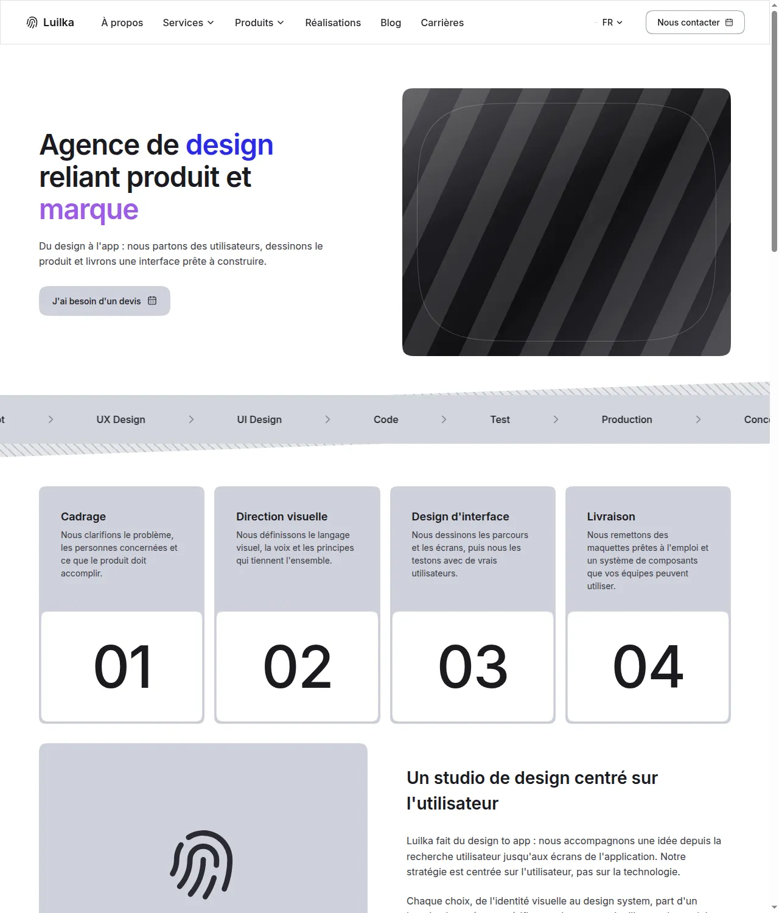
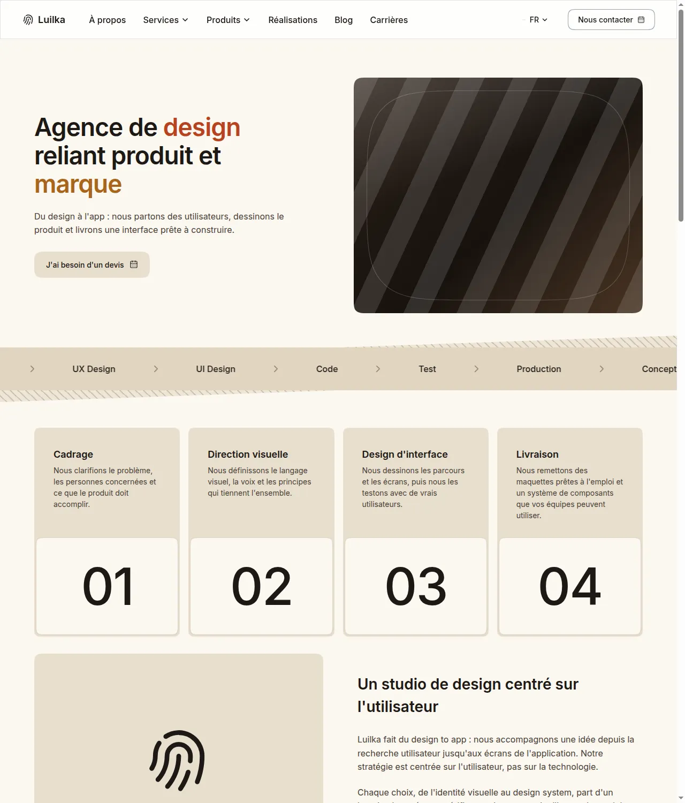
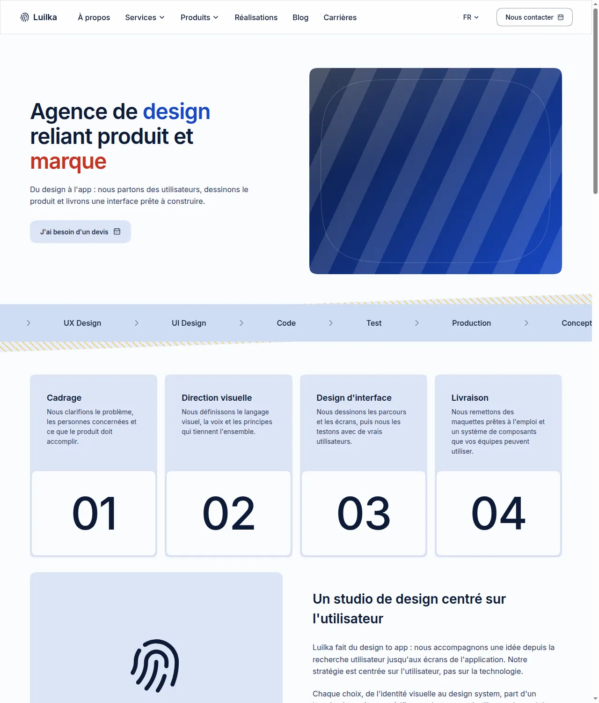

# Propositions de couleur

**Statut** : deux propositions, aucune appliquée. Depuis D-018, la base du thème est noir et blanc : ces options ne servent plus que comme couleur d'accent. À trancher par le titulaire, voir la décision 4 de [l'audit des pages](audit-pages-et-concurrence.md).
**Date** : 26 novembre 2026
**Documents liés** : [principes de design](design-principles.md), [audit des pages](audit-pages-et-concurrence.md)

## Pourquoi

Le gris-lavande et le dégradé bleu vers violet ne donnent pas d'identité au studio, et le bleu et le violet vifs ressemblent à ceux d'ustwo (voir le benchmark de l'audit). Les concurrents lus tiennent une couleur qu'on retient, souvent sur un fond chaud. Ces deux propositions testent deux directions sans toucher au code du site.

## Comment les captures ont été faites

Le site tourne en local avec `nx start`. Les valeurs des jetons de `src/globale.css` sont remplacées en direct dans Chrome, avec quelques règles pour les couleurs écrites en dur dans les composants (le bandeau, le fond du visuel de l'accueil, le pied de page). Les captures montrent donc l'effet, pas le résultat final : une couleur retenue passerait entièrement par les jetons, comme le demande le principe 12.

| Capture | Fichier |
|---|---|
| Site actuel | `propositions/accueil-actuelle.webp` |
| Option A | `propositions/accueil-option-a.webp` |
| Option B | `propositions/accueil-option-b.webp` |

## Option A : crème et rouille

Un fond crème chaud, une encre brune, une couleur signature rouille et un ocre. Elle rapproche Luilka de la chaleur d'Ojú, de NAKA et d'Afrostrength, tout en gardant une couleur propre. Les deux mots du titre passent de bleu et violet à rouille et ocre.

## Option B : bleu fleuve et soleil

Un fond presque blanc légèrement bleuté, une encre bleu nuit, un bleu franc pour l'action, un rouge pour le second mot du titre et un jaune soleil réservé aux motifs (les lignes obliques du bandeau). Le bleu, le rouge et le jaune évoquent le drapeau congolais, sans le copier : le jaune ne porte jamais de texte, car il ne passe pas le contraste sur fond clair.

## Valeurs

| Jeton | Actuel | Option A | Option B |
|---|---|---|---|
| `--paper` | `#ffffff` | `#fbf7f0` | `#fafbfe` |
| `--bg-soft` | `#f6f6fa` | `#f3ece0` | `#eef2fb` |
| `--gray` | `#cfd1db` | `#e8dfcf` | `#dce5f6` |
| `--gray-2` | `#b4b6bf` | `#d9cdb6` | `#c5d3ee` |
| `--gray-3` | `#a9abb4` | `#cbbd9f` | `#adc0e4` |
| `--text` | `#1a1a1f` | `#1d1814` | `#0d1a36` |
| `--muted` | `#3c3c45` | `#4a4037` | `#35415f` |
| `--blue` (liens) | `#2a4cb5` | `#a93d1c` | `#1747c4` |
| `--accent-blue` (premier mot) | `#2a2ae6` | `#b8431f` | `#1747c4` |
| `--accent-purple` (second mot) | `#9b5de5` | `#a8651a` | `#c4321f` |
| `--night` | `#0d0d10` | `#17120e` | `#0b1630` |
| `--border-ui` | `#dcdce2` | `#e0d6c4` | `#d5dff2` |

## Contrastes

Rapports de luminance relative de WCAG 2.2, calculés sur les valeurs ci-dessus. Seuils : 4,5 pour 1 pour le texte courant, 3 pour 1 pour les grands textes.

| Paire | Actuel | Option A | Option B |
|---|---|---|---|
| Texte sur fond | 17,3 | 16,5 | 16,7 |
| Texte secondaire sur fond | 10,9 | 9,5 | 9,8 |
| Texte sur carte | 11,4 | 13,3 | 13,6 |
| Texte secondaire sur carte | 7,2 | 7,6 | 8,0 |
| Lien sur fond | 7,5 | 5,8 | 7,4 |
| Premier mot du titre sur fond (grand texte) | 8,2 | 5,1 | 7,4 |
| Second mot du titre sur fond (grand texte) | 4,1 | 4,3 | 5,3 |
| Blanc sur le bouton sombre | 19,4 | 18,6 | 17,9 |

Les deux propositions passent le seuil AA. L'option B améliore même le second mot du titre, qui est aujourd'hui le plus faible de la palette actuelle.

## Ce que ces propositions ne disent pas

- Elles n'ont pas été testées auprès de visiteurs. Le choix reste une question d'identité, pas de mesure.
- La couleur ne dit pas à elle seule « Kinshasa » ou « Afrique » : c'est au titulaire de décider ce que la palette doit raconter.
- Une couleur retenue demande de remplacer les couleurs écrites en dur des composants par des jetons, ce qui est un travail à part.
